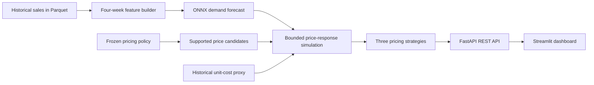

# PriceWise

**Retail pricing intelligence powered by FastAPI, ONNX Runtime, and Streamlit.**

PriceWise is an end-to-end Python project that turns historical cereal sales into **model-implied pricing scenarios**. A retailer can choose a product and store, evaluate supported selling prices, and compare three transparent strategies: **Conservative**, **Balanced**, and **Aggressive**.

It includes a trained demand model, a bounded pricing engine, a REST API, and an interactive dashboard. It is a **historical-data demonstration and decision-support prototype**, not a live pricing service or an autonomous price-setting system.

## What it does

- Forecasts weekly unit demand from recent product/store sales using a Random Forest exported to **ONNX**.
- Builds next-week features from the previous **four consecutive observed weeks** without using future sales.
- Applies frozen, training-derived price-support and promotion guardrails.
- Evaluates candidate prices in **$0.01 increments** with an observational, product-specific elasticity adjustment.
- Calculates model-implied units, revenue, unit margin, gross profit, and differences from the reference price.
- Selects three explainable business scenarios, or withholds them when policy/quality checks fail.
- Serves results via a **FastAPI** endpoint and visualizes them in **Streamlit**.

## Dashboard

The dashboard provides product and store controls, reference demand and cost metrics, three strategy cards, interactive demand/profit curves, and a downloadable scenario table.

> To add a screenshot to this README, save one as `docs/dashboard.png`, commit it, and add `` here.

## How it works



**Key separation:** Streamlit only calls FastAPI. The backend owns feature preparation, ONNX inference, pricing policies, business calculations, and strategy selection.

## Tech stack

| Layer | Technologies |
| --- | --- |
| Data preparation | Python, pandas, NumPy, PyArrow/Parquet |
| Experimentation | Jupyter, scikit-learn, statsmodels, Plotly |
| Model inference | ONNX Runtime (`skl2onnx` used for export) |
| Pricing logic | Typed Python modules, training-derived policy JSON |
| Backend | FastAPI, Pydantic, Uvicorn |
| Dashboard | Streamlit, Plotly, Requests |
| Testing | pytest, FastAPI TestClient/httpx |

## Project structure

```text
PriceWise_Starter/
├── streamlit_app.py               # Dashboard / API client
├── requirements.txt
├── pyproject.toml                 # Editable pricewise package
├── src/pricewise/
│   ├── data/features.py          # Historical and future feature builders
│   ├── ml/inference.py           # ONNX Runtime prediction interface
│   ├── pricing/
│   │   ├── policy.py             # Frozen support rules and price grid
│   │   ├── engine.py             # Demand, revenue and profit simulation
│   │   └── strategies.py         # Conservative / Balanced / Aggressive
│   └── api/
│       ├── schemas.py           # Pydantic request/response contracts
│       └── main.py              # FastAPI app and lifespan resources
├── models/
│   ├── pricewise_rf.onnx         # Trained model + preprocessing
│   └── pricewise_policy.json     # Elasticities and price-support metadata
├── data/processed/
│   └── cereal_focus.parquet      # REQUIRED local historical dataset
├── notebooks/                    # EDA and model development
├── scripts/                      # Data audit and cleaning scripts
└── tests/                        # Automated feature, model, policy and API tests
```

## Quick start

**Requirements:** Python **3.12** (the version used during development), a working pip environment, and the required local artifacts described below.

```bash
# From the repository root
python -m pip install -r requirements.txt
python -m pip install -e .
```

The application expects these files at the listed relative paths:

- `data/processed/cereal_focus.parquet` — focused, cleaned historical cereal observations.
- `models/pricewise_rf.onnx` — exported demand model.
- `models/pricewise_policy.json` — frozen support rules and elasticities.

**Data availability:** Raw/processed datasets are excluded from the suggested `.gitignore` by default. A fresh clone will **not run** until `cereal_focus.parquet` is supplied locally. Include it in a public repository only if its license/distribution terms permit that; otherwise provide an authorized download or a separately prepared distributable demo dataset. The model and policy files should also only be published if you have the necessary redistribution rights.

### 1. Start FastAPI (terminal 1)

```bash
python -m uvicorn pricewise.api.main:app --reload --host 127.0.0.1 --port 8000
```

- Health check: <http://127.0.0.1:8000/health>
- Interactive API docs: <http://127.0.0.1:8000/docs>

### 2. Start Streamlit (terminal 2)

```bash
python -m streamlit run streamlit_app.py --server.address 127.0.0.1 --server.port 8501
```

Open **<http://127.0.0.1:8501>** and select **Cheerios 15 oz**, **Store 101**, then **Evaluate prices**.

Both servers must remain running. Stopping Uvicorn with `Ctrl+C` also stops the backend the dashboard calls.

### 3. Run tests

```bash
python -m pytest -q
```

**Last verified milestone:** 46 tests passed across the project, including the HTTP layer. The Streamlit UI still needs its own manual browser check after installation.

## REST API

`GET /health` checks whether the application has initialized its resources.

`POST /api/v1/pricing/scenarios` evaluates a supported product-store scenario:

```bash
curl -sS -X POST http://127.0.0.1:8000/api/v1/pricing/scenarios \
  -H 'Content-Type: application/json' \
  -d '{"upc":"1600066610","store":101,"promo_context":"UNMARKED"}' \
  | python -m json.tool
```

The JSON response includes a reference forecast, the three strategy decisions, the complete candidate-price curve, and a historical-data disclaimer. The server uses the latest observed week for the requested product/store and forecasts the following week.

| Response | Meaning |
| --- | --- |
| `200` | Scenarios evaluated; individual strategies may still be withheld |
| `404` | No historical observations for the requested product/store |
| `409` | Historical observations exist, but the frozen pricing policy does not support the scenario |
| `422` | Invalid request body |

## Verified example

The following is a **historical demonstration**, using **Cheerios 15 oz, Store 101, reference week 399 → forecast week 400** (not a current calendar-week forecast).

| Metric | Value |
| --- | ---: |
| Reference price | $3.35 |
| Reference predicted units | 36.80 |
| Estimated unit acquisition-cost proxy | $2.8251 |
| Evaluated price range | $3.02–$3.59 |
| Price candidates | 58 |
| Reference modeled gross profit | $19.32 |

| Strategy | Scenario price | Predicted units | Modeled gross profit |
| --- | ---: | ---: | ---: |
| Conservative | $3.32 | 37.42 | $18.52 |
| Balanced | $3.54 | 33.20 | $23.74 |
| Aggressive | $3.59 | 32.35 | $24.74 |

**Strategy objectives:** Conservative protects modeled volume and at least 95% of reference modeled profit; Balanced maximizes modeled gross profit subject to a 10% volume-loss cap; Aggressive favors a higher qualifying price subject to a 15% volume-loss cap. All three remain subject to common price-support, margin, and cost-stability restrictions.

## Modeling approach and limitations

The project began with approximately **6.6 million** raw cereal observations, then narrowed the modeling scope to **two products** (Cheerios 15 oz and Corn Flakes 18 oz). About **59,466** observations entered the focused dataset, and **53,647** were eligible for model features.

- The Random Forest predicts reference demand using historical demand, prior price, product/store identifiers, promotion context, seasonality and candidate-price-related features.
- An observational log-linear analysis estimated separate price-elasticity coefficients for the two products. Those estimates are **not causal effects**.
- A bounded hybrid calculation adjusts the ONNX reference-demand forecast across frozen training-supported prices; pricing results are **model-implied simulations**, not verified commercial gains.
- The historical validation and held-out test revealed meaningful forecasting errors and narrow operational support, especially for Corn Flakes. On the held-out test, the pricing policy covered **28.14%** of all rows, including **55.10%** of Cheerios rows and **1.06%** of Corn Flakes rows.
- Training excluded invalid/nonpositive-price and zero-sales observations; demand can be affected by promotions, inventory constraints, omitted variables, and selection bias.
- The application has **no authentication or authorization** and is configured for local development. **Do not expose it directly on the public internet** without a deployment/security layer.
- No endpoint changes real retail prices. Human review is required before using any scenario for business action.

## Development status

- [x] Data auditing and cleaning
- [x] Two-product exploratory analysis and feature engineering
- [x] Chronological model validation and held-out testing
- [x] ONNX export and numerical parity checks
- [x] Pricing policy, scenario engine and three strategies
- [x] FastAPI endpoint and HTTP tests

---

**PriceWise is a portfolio-quality learning and engineering prototype built around honest model evaluation, explicit support boundaries, and reproducible API-driven pricing simulations.**
